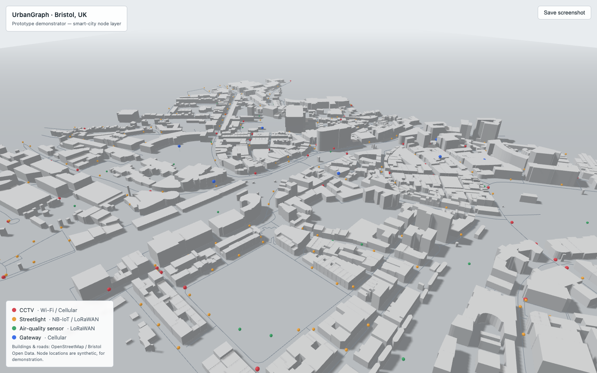
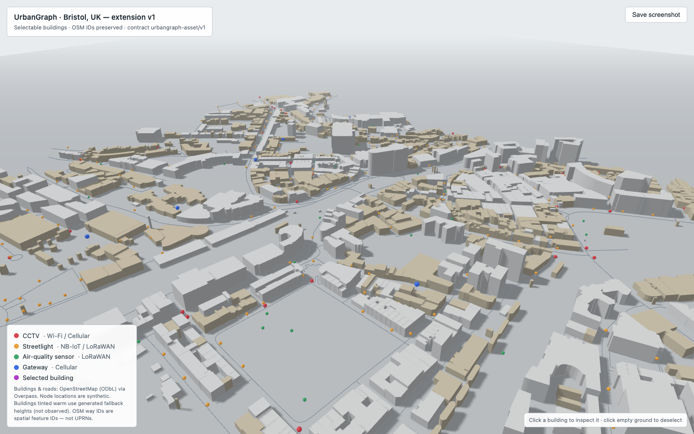
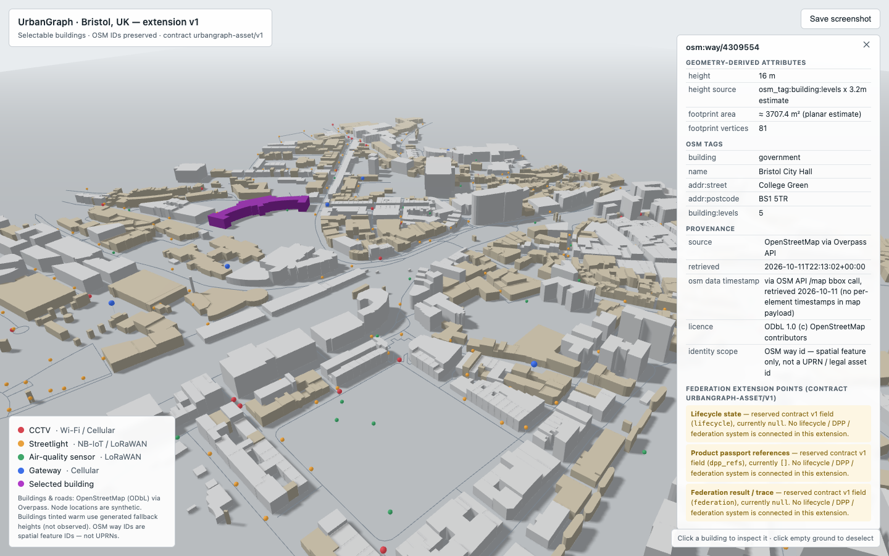

# UrbanGraph Bristol

A small Three.js urban-asset visualisation prototype for a Bristol (UK) study area, plus
**Extension v1**: individually identifiable and selectable buildings, provenance-aware
asset panels, and a versioned JSON contract (`urbangraph-asset/v1`) that acts as a
documented extension point for future lifecycle, digital-product-passport and federation
results.

This repository is pre-award technical evidence for the **TwinBridge** research concept
(UrbanGraph-enabled AEC digital-twin federation). It is a visualisation layer only — it
has **no backend, no persistent state, no API and no federation**, and does not claim to
be a digital twin.

## What Extension v1 adds over the original demonstrator

- **Preserved identifiers**: every building keeps its source OSM way ID through the whole
  ingestion pipeline (1,341 buildings, all uniquely identifiable).
- **Per-building picking**: click any building in the 3D view.
- **Asset information panel**: building ID, geometry-derived attributes, height with
  explicit provenance class, and data source.
- **Honest attribute classes**: heights are labelled measured (`osm_tag:height`, 6),
  estimated (`building:levels × 3.2 m`, 550) or synthetic fallback (785, visually tinted
  and flagged — never presented as real data).
- **Versioned JSON contract**: `extended/urbangraph_asset_contract_v1.schema.json`
  reserves null fields for future lifecycle state, product-passport references and
  federation results, without implementing those systems.

The original demonstrator is preserved byte-identical in `original/`; the extension lives
in `extended/`. See [CHANGELOG.md](CHANGELOG.md),
[FEASIBILITY_REPORT.md](FEASIBILITY_REPORT.md) and
[REPRODUCIBILITY.md](REPRODUCIBILITY.md) for the full evidence trail.

## Screenshots

| Before (original) | After (Extension v1) |
|---|---|
|  |  |

Selected building (Bristol City Hall) with asset panel:



## Quick start

```bash
cd extended
python3 -m http.server 8000
open http://localhost:8000/index.html
# click any building, or deep-link:
open "http://localhost:8000/index.html?select=osm:way/4309554"   # Bristol City Hall
```

Regenerate the data (requires Python 3 + `requests`):

```bash
cd extended && python3 fetch_bristol.py        # when Overpass is reachable
# or reproduce from the cached snapshot (no network needed):
cd extended && python3 run_cached.py fetch_bristol.py
```

Full reproduction steps, including the observed Overpass outage and the tested
official-OSM-API fallback, are in [REPRODUCIBILITY.md](REPRODUCIBILITY.md).

## Data provenance and licence

- Geodata © [OpenStreetMap](https://www.openstreetmap.org) contributors, licensed under
  the [Open Data Commons Open Database License (ODbL)](https://opendatacommons.org/licenses/odbl/).
  Retrieval snapshot: 2026-10-11 (`osm_map.osm`, 23,579 nodes / 3,950 ways; converted
  Overpass-style cache `overpass_cache.json`).
- Building heights are classed measured / estimated / synthetic as described above;
  estimated and synthetic values are research artefacts, not surveyed facts.
- Code in this repository is released under the MIT licence; derived OSM data remains
  ODbL with attribution as given here.

## Status

Research prototype, frozen as evidence (October 2026). The roadmap items it documents
(read-only asset service, lifecycle state, passport linkage, federation) are proposed
research, not implemented features.
